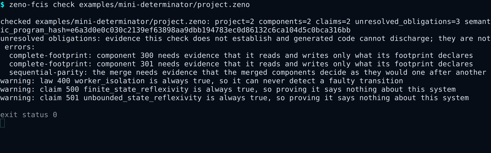
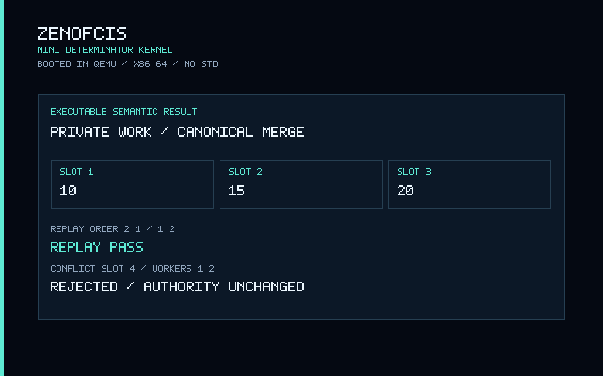
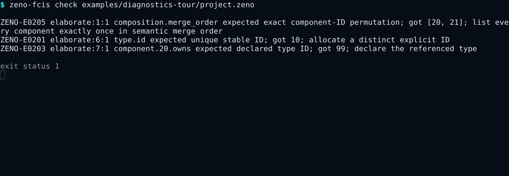

# ZenoFCIS

**Toward a neurosymbolic software factory for high-assurance FCIS applications.**

ZenoFCIS is a Rust library family for functional-core / imperative-shell
(FCIS) systems. It combines LLM-assisted generation with symbolic checking: LLMs
propose specifications and programs, and deterministic checkers decide whether
supported artifacts meet their declared contracts. The assurance comes from
those contracts and qualified checks, whichever model makes a proposal.

It serves three kinds of user:

- **developers**, who review declarative rules and test the library's
  decisions with explicit inputs;
- **LLMs**, which get a bounded generation target and reproducible checks;
- **agents**, which get reproducible, machine-readable feedback.

[What this gives developers, LLMs, and agents](#what-this-gives-developers-llms-and-agents)
describes each in detail.

ZenoFCIS aims to become a **state-of-the-art, high-assurance software
factory**: one that turns reviewed requirements into applications built around
a **formally verified functional core**, with durable effects and evidence that
agents can maintain. This describes where the project is heading; comparative
leadership remains a claim to demonstrate.

## The assurance goal and its current scope

V2's central assurance goal is a **formally verified functional core**: a pure,
total decision boundary with a machine-checked proof that its executable
implementation follows its versioned decision contract for every input in its
admitted domain:

```text
For every admitted input x:
    executable_core(x) = decision_contract(x)
```

The contract specifies the complete decision: Accept, Reject or
CommittedFailure; its reason, successor state, patch and ordered effect plan;
and its law, genesis, resource and refusal rules. The proof must cover the
executable decision path and the connections between its stages.

The supported V2 route uses this boundary:

```text
reviewed decision contract + immutable original inputs
    -> verified library admission, execution and law evaluation
    -> exact decision and bound authorization
    -> imperative-shell persistence and delivery
```

The supported V2 API requires this path. It refuses unsupported contracts and
prevents application callbacks from substituting authoritative decisions.
Synthesis and LLMs can propose contracts and programs; admission and execution
must preserve the same assurance whoever produced them. Each guarantee names
the exact implementation, specification, full supported input domain and
trusted-base assumptions.

**What is checked today.** The 2.5.0 release uses the supported checked
program and mandatory Authority route. Its assurance is executable conformance to a
reviewed contract across the supported domain, under named trusted
assumptions. [Release assurance](docs/RELEASE_ASSURANCE.md) states the
required checks and their scope.

**What the assurance does not cover.** It does not establish that the
requirements match human intent, that external observations are true, or that
a destination performs an effect correctly. These results do not establish a
formal guarantee for arbitrary functional cores, or for an application's
complete shell and external environment. Reviewing whether the rules capture
the intended product behavior remains essential. External fact authentication,
storage atomicity and effect delivery have their own assurance obligations in
the imperative shell. A passing stage check is not a release receipt.

## Release status

**2.5.0** is the current release source. It builds on the first stable V2
line, 2.3.0; the [2.5.0 release notes](docs/RELEASE_NOTES.md) describe the
new arithmetic, search, loop and contract-judge features. Final qualification
and publication remain separate release gates. The initial release provides the
**Linux x86_64 GNU CLI** (glibc 2.39 or later). A **macOS on Apple silicon**
(`aarch64-apple-darwin`) binary will follow native platform validation.
Every published archive must pass its build, custody and installed-binary checks. See
[installation](docs/INSTALLATION.md) and the
[workflow qualification scope](docs/FEATURE_MATRIX.md#host-platforms).

[Release assurance](docs/RELEASE_ASSURANCE.md) describes the required checks
and trusted assumptions. Source verification and qualification, exact-head
CI, hosted qualification, packaging, signing and publication remain distinct
steps.

The earlier public [2.2.0-rc.1](https://github.com/TheDarkLightX/ZenoFCIS/releases/tag/v2.2.0-rc.1)
and [2.3.0-rc.1](https://github.com/TheDarkLightX/ZenoFCIS/releases/tag/v2.3.0-rc.1)
prereleases keep their exact sources and limits in the
[candidate record](docs/RELEASE_CANDIDATES.md). The historical `1.1.0` release
and its [release notes](docs/V1_1_RELEASE_NOTES.md) have their own scope;
The 2.3.0 cutover changed the public execution API; 2.5.0 retains that boundary.

## Install and run a first example

The normal V2 library route declares a complete checked program. It is
available in the 2.5.0 release, both with default features and with
`default-features = false`. The historical `1.1.0` package has its own V1 API.

After qualification and publication, check out the `v2.5.0` tag as the [installation guide](docs/INSTALLATION.md)
describes, then bind the dependency to that source:

```toml
[dependencies]
zeno-fcis = { path = "../ZenoFCIS/crates/zeno-fcis", default-features = false }
```

```rust
use zeno_fcis::prelude::*;
```

A program goes through these steps:

```text
original schema + complete ProgramDefinition + reviewed policy + framing/channel roots
    -> bind_catalog
    -> bind_program (private library-owned Program)
    -> original state/command/context envelopes
    -> actual decision + shared meter + laws
    -> private Publication or audited Reject/refusal
```

Run the smallest example with
`cargo +1.97.1 run --locked --offline -p zeno-fcis --example minimal_core`.

The root and prelude cutover was introduced in 2.3.0 and remains in 2.5.0.
Native transition callbacks, public candidate sealing and caller-supplied
usage have been retired. `zeno_fcis::legacy` retains inert compatibility data
and standalone evidence utilities. The
[API migration guide](docs/V2_PROGRAM_API_MIGRATION.md) describes the supported
invocation and publication boundaries.

Select only the features your boundary needs. The `full` feature is intended
for workspace integration and exploration, not for reusable libraries.

The repository checks these runnable examples permanently:

```bash
cargo +1.97.1 run -p zeno-fcis --example minimal_core --locked
cargo +1.97.1 run -p zeno-fcis --example checked_backend --features backend --locked
python3 tools/atdd.py run --all
```

## Where to go next

The [documentation index](docs/INDEX.md) lists every guide by task. Common
starting points:

- **Build an application:** the [installation guide](docs/INSTALLATION.md),
  [quickstart](docs/QUICKSTART.md), [2.5.0 release notes](docs/RELEASE_NOTES.md),
  [API reference](docs/API_REFERENCE.md), [crate map](docs/CRATE_MAP.md) and
  [feature matrix](docs/FEATURE_MATRIX.md). The
  [CLI reference](docs/CLI_REFERENCE.md) describes the supported generation,
  specification review, finite optimization, checked adoption and upgrade
  commands.
- **Work with LLMs and agents:** the [LLM integration guide](docs/LLM_USAGE.md).
  Agents can discover the CLI with `zeno-fcis describe` and inspect generation
  drift with `zeno-fcis generate --out generated --check --format json`. The
  optional [developer guardrails](docs/DEVELOPER_GUARDRAILS.md) reject selected
  unsafe coding-agent actions before they run.
- **Check product scope:** the [V1 product contract](docs/V1_PRODUCT_CONTRACT.md)
  defines the stable V1 feature scope and supported adopter journeys, and
  [BDD and ATDD](docs/ACCEPTANCE_TESTING.md) bind those journeys to fixed
  executable commands. The [V1.1 release notes](docs/V1_1_RELEASE_NOTES.md)
  describe V1.1's new workflows and compatibility boundaries; the
  [V1 release notes](docs/V1_RELEASE_NOTES.md) retain the original stable API
  scope.
- **Review security:** the
  [LLM cybersecurity review orchestrator](docs/LLM_CYBERSECURITY_REVIEW.md),
  [evidence-first playbook](docs/SECURITY_REVIEW_PLAYBOOK.md),
  [EPI hotspot model](docs/SECURITY_HOTSPOT_MODEL.md) and
  [dated standards snapshot](docs/SECURITY_STANDARDS_SNAPSHOT.md) provide a
  deterministic review queue, constrained prompts for less-capable models,
  exploit-chain proof obligations, scanner guidance and a machine-readable
  report contract. Run `python3 tools/security_hotspots.py check` to reject
  unreviewed ranking or model drift.

## Why functional core, imperative shell

Many failures in stateful systems come from deciding and acting in the same
step. A function reads a clock, updates a row, calls a service, and chooses an
outcome. Mixing decisions with external actions makes independent replay and
checking harder. ZenoFCIS separates deciding from acting, then makes the
boundary enforceable.

The design rule is:

```text
immutable state + command + policy + supplied context
    -> pure total transition
    -> Accept | Reject | CommittedFailure
    -> exact immutable candidate
    -> atomic imperative-shell interpretation
```

The semantic kernel treats values, decisions, resource budgets, canonical
bytes, and commitments as explicit protocol data. It forbids unsafe Rust and is
designed for `no_std + alloc` use without clocks, randomness, networking,
filesystems, databases, or executable effect closures.

**The core decides.** A transition is a pure, total function from immutable
inputs to exactly one decision:

- accept, with a candidate;
- reject, with a reason and no change;
- commit a failure, with a reason and a candidate.

The candidate is data: an exact successor, patch, ordered effects and measured
resource use. In the supported V2 route, applications declare a closed program
and policy. The library interprets them without application callbacks, ambient
clocks, environment reads or randomness. Time and external observations enter
as explicit inputs.

Finite synthesis can propose the scalar program, and independently written
examples and conformance tests challenge the declarations. Purity scans,
repeated-run probes and history replay remain useful detectors, but a clean
result from them is not a proof of determinism or of agreement with human
intent. [Determinism](docs/DETERMINISM.md) describes those checks and their
limits.

**The shell acts.** Persistence, delivery and every external operation happen
outside the core. Outbox entries have transaction-bound delivery identities,
and a destination must implement the acknowledgement and deduplication
contract. A stable ID alone does not prove exactly-once external execution.

**Authority is a value.** The V2 SQLite shell accepts private library
publications. The library admits the schema and declarations, computes the
complete decision and resource use, evaluates applicable declared laws, and
binds the publication to the exact policy, evaluator and invocation. A project
cannot substitute a law-verdict callback or construct a publication itself.
Genesis has its own law checks, and reopening a store replays its history.

The strategic shape follows from one rule: **untrusted components propose, and
small deterministic checkers judge.** Code written by a person or an LLM,
synthesizers, solver models, databases, and mounted runtimes may all propose
values. Strict decoders, exhaustive checkers, replay, and the authority decide
what is admitted, and their verdicts are types that other code cannot forge.
The assurance argument names its trusted base: the reviewed specification,
Verus and its solver/library, compilers, identity generation and checks,
cryptographic assumptions, and the platform. Storage and external delivery
have separate obligations. A solver result and an independently checked proof
keep their distinct evidence classifications.

```text
proposers (untrusted)          judges (small, deterministic)       shell (effects)

application or LLM code  ─┐    canonical decode                    atomic publication
synthesizer or solver     ├──> schema and catalog admission   ──>  outbox delivery
mounted runtime or store ─┘    authority execution + law checks    with stable IDs
                               nominal authorization
```

The aim is to keep the part a person must review small: the meaning of each
decision, stated as types, reasons, laws, and claims. Machines check the rest
against it. Every published decision is checked against the laws, a finite
core is checked against its contract on every input, and each result states
what it establishes. [Design record 0003](docs/adr/0003-epistemic-status.md)
classifies every status as Identified, Attested, Checked, or Proved, with its
scope and trusted base, so a passing check is not mistaken for more than it
shows. The [principles](docs/adr/0002-principles.md) and
[architecture](docs/ARCHITECTURE.md) describe the full design.

### What this gives developers, LLMs, and agents

- **Developers** review declarative rules and test the library's decisions with
  explicit inputs. Decisions are data, so tests compare exact bytes and a
  failure replays from its inputs. Reviewers start from the catalog of reasons
  and the laws. Generated typed APIs name each state field, so code need not
  use raw paths, and specification diagnostics arrive together in one pass.
- **LLMs** get a bounded generation target: declarations with explicit inputs
  and outputs, interpreted by the library, plus reproducible checks. The design
  assumes generated code can be wrong:
  - generated typed APIs narrow what it needs to write;
  - every decision is checked against the project laws before it can be
    published;
  - a finite decision core can be synthesized and verified exhaustively
    instead of being written by a person or an LLM;
  - an [inductive claim](docs/INDUCTIVE_CLAIMS.md) checks an invariant over
    the full integer range, by induction over the declared action laws that
    the authority enforces. The solver's `unsat` for the step is attested, not
    independently checked.
- **Agents** get reproducible, machine-readable feedback:
  - `zeno-fcis describe` and versioned JSON results with stable exit codes;
  - counterexamples to repair against: a synthesis refutation, or a solver
    model replayed through the interpreter;
  - a closed registry of acceptance commands;
  - gate evidence stamped with the exact commit it tested.

  Checks also catch work that passes without meaning anything.
  `zeno-fcis check --require-substantive` refuses laws and claims that no
  transition outcome can change, and `--require-resolved-paths` refuses laws
  and claims that read fields the schema does not declare.

## See it run

These captures show the earlier CLI and Mini Determinator workflow. They are
historical demonstrations, not qualification of the smaller V2 source.

The first capture shows the CLI in a virtual terminal. One command reads the
Mini Determinator project and reports its typed components, claims, remaining
checks, and content-bound program identity.

[](docs/tutorials/MINI_DETERMINATOR.md)

The Mini Determinator links the public semantic core into a freestanding Rust
kernel, boots through UEFI in QEMU, checks opposite worker completion orders,
and rejects conflicting private writes without changing authoritative state.

[](docs/QEMU_MINI_DETERMINATOR.md)

Specification errors accumulate in one bounded pass. This deliberately invalid
example reports a duplicate stable ID, an unknown type reference, and an
invalid merge order together:

[](docs/tutorials/MINI_DETERMINATOR.md#see-three-specification-mistakes-at-once)

Start with the worked [Mini Determinator tutorial](docs/tutorials/MINI_DETERMINATOR.md),
reproduce the [QEMU capture](docs/QEMU_MINI_DETERMINATOR.md), or browse all
[CLI and QEMU captures](docs/assets/marketing/README.md).

## Canonical bytes and byte-level enforcement

Canonical bytes are the one permitted byte representation of an admitted
semantic value. ZCVE/1 fixes type tags, integer and length encodings, field and
map-key order, collection shape, and optional/sum representation. Its bounded
decoder rejects malformed structure, duplicate or reordered entries, trailing
bytes, and every input that does not equal a canonical re-encoding of the
decoded value:

```text
untrusted bytes
    -> bounded structural decode
    -> typed immutable value
    -> canonical re-encode
    -> require original bytes == re-encoded bytes
    -> schema and authority admission
```

This makes state roots, candidate IDs, receipts, replay bindings, and evidence
commitments deterministic across supported implementations. Canonical bytes
are not encryption, and they do not establish business correctness by
themselves. Schemas establish shape; catalogs, invocation witnesses, project
laws, and nominal authority establish what the bytes mean and whether they may
be published. See the [canonical-bytes guide](docs/CANONICAL_BYTES.md).

## Example applications

`zeno-fcis new DIR --template NAME` creates a complete application: an
authored `project.zeno`, generated typed bindings, declarative decision and
law programs that the library evaluates before publication, a SQLite store
with an outbox, tests, and a README that states its rules.

| Template | What it shows |
| --- | --- |
| `durable-counter` | The smallest complete application: a synthesized step, runtime laws, a committed failure, and restart with delivery retry. |
| `account-lockout` | Failed logins committed as failures, time as an input instead of a clock read, authority from the request context, alerts through the outbox, and an inductive claim, attested by CVC5 over the integer ranges `project.zeno` declares, that the action laws alone keep the lock invariant. |
| `order-fulfillment` | A declarative state machine that sends idempotent payment and shipping requests and rejects duplicate or late callbacks. |
| `inventory-reservation` | A decision core synthesized and verified on all 864 inputs, commands with quantities, and a conservation law. |
| `compliance-gateway` | An expert system's rule base as the synthesis contract, checked on all 2,880 inputs (its 720 feature combinations, with both actions and both reviewer values). Every decision names the rule that fired; a rule base with a conflict, a gap, or a dead rule fails the build; and claims for `zeno-fcis prove` state the strikes invariant's inductive steps. |
| `withdrawal-queue` | A controller step synthesized by `zeno-fcis synth` from a sketch of a fair policy, whose table an external checker, OrbitSynthesis, certified for every input sequence (re-checked by the application's `tests/controller.rs`), so an alarm can delay a withdrawal but never freeze it; a refinement law that ties each tick to that finite model; and inductive claims, attested by CVC5, that the action laws alone keep the vault solvent. |
| `agent-treasury-guard` | An AI agent as an untrusted proposer: a treasury that commits at most its daily budget, keeps its reserve, and bounds slippage against the oracle price, decided by a core synthesized and checked on all 6,144 fact tuples; inductive claims, attested by CVC5, that the action laws alone keep the reserve, the daily budget, and the swap bookkeeping; and SwapIntent-shaped requests to ZenoDEX. |
| `prepared-counter` | Checked bounded completion and prepared batches with a bounded publication size. |

In the account-lockout, order-fulfillment, inventory-reservation,
compliance-gateway, withdrawal-queue, and agent-treasury-guard examples, every
law formula in `project.zeno` can constrain some transition and reads only
declared fields (`zeno-fcis check --require-substantive
--require-resolved-paths` passes). Each also ships decision examples, a
conformance test through the running application, and determinism checks.

`python3 tools/check_generated_application.py` creates, builds, and tests each
template in this table as an isolated package against this checkout. Each
application's core builds without its SQLite shell
(`cargo build --no-default-features`), including for `wasm32-unknown-unknown`,
which the same gate checks. `site/` runs the account-lockout example in the
browser through that build.

### An application from its contract

`zeno-fcis new DIR --contract CONTRACT` builds an application from a contract
directory alone: `project.zeno`, the decision rules and genesis state in
`v2/policy.json`, and, optionally, `tests/decision-examples.txt`. `new` binds
the application to the ZenoFCIS source tree the CLI was built from, or to the
one `--source` names, so it builds against that tree with no other step. The
[contract rules reference](docs/CONTRACT_RULES.md) describes every key of
`v2/policy.json`.

`zeno-fcis generate contract DIR` regenerates `v2/schema.zcve`,
`src/v2_contract.rs` and `v2/policy.zcve` from the first two; with `--check`
it changes nothing and names each file that differs. Every template above is
checked this way. The application's own source is the same for every
contract: the library Authority makes each decision and checks each law,
while the application frames inputs, keeps publications in SQLite and
delivers the outbox. [Dual approval](examples/dual-approval/README.md), a
payment released only after two different officers approve it, is built this
way.

`zeno-fcis contract review DIR` writes an advisory packet. It reports what the
library decides on every input of a small domain, or on a boundary set of a
large one; whether that agrees with `tests/decision-examples.txt`; which law
refusals fall on states the contract's state laws allow; and which rule
mutants those inputs distinguish, each with a proposed example.

To improve an existing finite program, use `zeno-fcis optimize`: it searches
for fewer instructions and smaller encoded programs, checking each accepted
replacement against the original on every declared input. Use `transform
check` for a replacement you already have. Neither command adopts the result
or promises a globally optimal program.

For repeated proposals, use `zeno-fcis loop`: open a bounded session, submit
candidates, inspect counterexamples, revise, and resume from checked evidence.
The other loop commands help learn from examples, complete expression holes,
and ask about decisions left open by contract laws. Each has its own checked
scope; fitting examples alone does not prove behavior on unseen inputs. The
[agent guide](docs/LLM_USAGE.md#choose-the-tool-for-the-problem) maps tasks to
commands, and the [CLI reference](docs/CLI_REFERENCE.md#bounded-optimization-loop)
gives the complete workflows.

`zeno-fcis contract export-program DIR --out P` writes the contract's
decision program in the encoding that `optimize` and `transform` read.
`zeno-fcis contract adopt DIR --candidate C --receipt R --usage
new-version` makes a candidate decision program the contract's next version
after a `transform` receipt establishes equivalence with the current program
over the declared finite domain. It keeps the superseded version unchanged
beside it.

An adoption changes only the decision program and its Step limit. The
application's `--upgrade` therefore moves a store at any state to the new
version once the SQLite shell has established the five premises of a program
succession itself, including its own comparison of the two decision programs
on every input tuple: 1,296,000 for the withdrawal queue. It records a
chained, replayable upgrade that binds that count and the adoption's receipt
digest. Under those premises the two versions reach the same states, so the
upgrade keeps every law and proved inductive claim. Step usage can change,
which makes it a new contract version. Other changes need a record from
`contract evolve` (a rename, data migration or rule change). Without one, the
new contract's genesis laws must admit the store's state (for a generated
contract, its declared genesis state). See the
[CLI reference](docs/CLI_REFERENCE.md#contract-adoption-and-store-upgrades).

`zeno-fcis contract diff OLD NEW` names the kind of a change between two
contracts: identical, program successor, rename, layout change, rule change
or unrelated. It lists every changed item and the upgrade path that kind
needs. It decides only the structural kind and runs no decision. A program
successor, a rename, or a data migration whose forward simulation passes
upgrades a store at any state; a rule change upgrades a store whose state
satisfies the new state laws and claims. See
[contract change classification](docs/CLI_REFERENCE.md#contract-change-classification).

## Specification and checked synthesis

V1 includes the inert `.zeno` language, a canonical typed project AST,
accumulated diagnostics, bounded relational and temporal logic, deterministic
formal-tool adapters, and the `zeno-fcis` CLI. Start with the
[specification contract](docs/RC3_AUTHORING_CONTRACT.md),
[language specification](docs/ZENO_LANGUAGE_V1.md),
[temporal semantics](docs/TEMPORAL_LOGIC_V1.md),
[formal-tools contract](docs/FORMAL_TOOLS_RC3.md),
[Mini Determinator reference](docs/MINI_DETERMINATOR.md),
[Mini Determinator QEMU kernel demo](docs/QEMU_MINI_DETERMINATOR.md), and
[CLI reference](docs/CLI_REFERENCE.md).

```bash
cargo +1.97.1 run -p zeno-fcis-cli --locked -- new /tmp/zeno-demo --template minimal
cargo +1.97.1 run -p zeno-fcis-cli --locked -- check /tmp/zeno-demo/project.zeno
cargo +1.97.1 run -p zeno-fcis-cli --locked -- generate \
  /tmp/zeno-demo/project.zeno --out /tmp/zeno-demo/generated
cargo +1.97.1 run -p zeno-fcis-spec --example mini_determinator --locked
python3 tools/qemu_demo.py run
```

The tutorials cover [language specification](docs/tutorials/LANGUAGE.md),
[composition](docs/tutorials/COMPOSITION.md),
[temporal claims](docs/tutorials/TEMPORAL.md),
[formal tools](docs/tutorials/FORMAL_TOOLS.md),
[Mini Determinator replay](docs/tutorials/MINI_DETERMINATOR.md), and the
[CLI workflow](docs/tutorials/CLI.md).

The optional QEMU command builds a freestanding `no_std` kernel, boots it
through UEFI, and validates its guest serial result. It requires QEMU, OVMF,
ImageMagick, and the documented pinned nightly toolchain. It is not part of the
default library build.

`.zeno` source and every derived view are non-authoritative specification input.
Only the lowered typed AST has canonical identity, and concrete machines still
bind through the existing authority-gated constructors.

### What synthesized code is guaranteed to do

**A synthesized program is guaranteed correct in a precise sense: it satisfies
its contract on every input the contract admits.** That result is a proof, not
a sample. It covers the selected program as the library's interpreter runs it.
Emitted Rust, Python, or JavaScript source carries the same guarantee once
`zeno-fcis synth verify` passes for that exact source and target. The proof is
about the contract as written, and it assumes that a small checker is correct.

#### Exhaustive verification, not correct by construction

A program can be guaranteed to meet its specification in two ways. ZenoFCIS
synthesis uses the second.

| | Correct by construction | Correct by exhaustive verification |
| --- | --- | --- |
| How correctness is shown | Every step that builds the program preserves correctness, so the result must be correct | The program is found by any method, then checked on every input the contract admits |
| What you trust | The construction rules and the tool that applies them | The checker: the `finite-i128/1` interpreter and its enumeration of inputs |
| If the builder has a bug | A wrong program can come out with no warning, unless the tool is itself verified | A wrong candidate fails the check and is never selected |
| What it can cover | Unbounded input domains | Finite domains small enough to enumerate |

Both are proofs. Checking every case of a finite domain is a proof by
exhaustion: the same kind of proof as showing that a statement holds for the
numbers 1 to 100 by checking each one. The two differ in where the trust sits
and in how many inputs they can cover, not in how strong the result is within
its domain. [Design record 0003](docs/adr/0003-epistemic-status.md) classifies
a selected program as Proved.

Exhaustive verification checks the final program, not the process that
produced it. The interpreter checks the selected program itself. Then
`zeno-fcis synth verify` replays the exact emitted source on every case in its
target runtime, so it also catches an error in code generation. Until that
command passes, the emitted source is unverified.

Agents building applications can install the repository's
[synthesis-first skill and MCP tools](docs/LLM_SYNTHESIS.md). They guide
agents to synthesize a finite pure core when it fits, and to check the
application adapter separately.

#### How a program is synthesized

1. A realizability check confirms that every admitted input has at least one
   acceptable output, or reports the input that has none.
2. A search enumerates the candidates of a reviewed sketch in a fixed canonical
   order.
3. A separate checker runs each candidate on every admitted input. Only a
   candidate that satisfies the contract everywhere is selected.
4. `zeno-fcis synth run` writes the program as Rust, Python, or JavaScript
   source and reports `runtime_conformance: not-run`. A separate command,
   `zeno-fcis synth verify`, replays that exact source in its target runtime on
   every admitted input and compares each output with the interpreter and the
   contract.

The guarantee for a selected program rests on the checker, not the search, so
a heuristic or AI proposer could replace the enumerator without weakening it.
A "no solution" result is different. It is a proof only because the library's
search covers every candidate in the sketch, so it also trusts that
enumeration. A search whose budget does not cover every candidate is refused
before it starts, and that refusal never counts as evidence of no solution.

#### What is guaranteed, and what it depends on

For every input in the declared finite domain, the selected program's output
satisfies the contract. Emitted source has the same property once
`synth verify` passes for it. Inputs outside the domain are refused rather than
answered. Finite synthesis handles up to 65,536 admitted inputs, 4,096 possible
outputs, 16 fields on each side of a contract, 64-bit integers, and 1,000,000
candidate programs.

The guarantee depends on four things:

- **The contract must say what you mean.** The program is proven to match the
  contract, not your intent, and a wrong contract yields a program that is
  faithfully wrong. This is the largest risk, so the durable-counter template
  also checks decision examples that were reviewed against its README.
- **The checker must be correct.** The V1 end-to-end synthesis path trusts its
  interpreter and enumeration. The V2 route has source-bound executable
  interpreter, admission, decision and authority evidence, with the scope and
  trusted assumptions recorded in the [2.5.0 release notes](docs/RELEASE_NOTES.md).
- **The code around the program needs its own check.** In the durable-counter
  template, `tests/conformance.rs` runs all 64 admitted inputs through the real
  application: admission, the authority, the adapter that turns outputs into
  decisions, and the law checker. It compares every decision, reason, state
  change, and notification with the model.
- **Emitted source needs its own replay, and the target runtimes are trusted.**
  `synth verify` binds its report to the exact source, the emitter, and the
  runtime's executable hash and version. It accepts only Rust 1.97.1, Python 3,
  and Node.js 22. The repository's synthesis check runs it in all three: for
  the durable-counter template on all 64 inputs, for the inventory-reservation
  template on all 864, and for the compliance-gateway template on all 2,880.
  Production must run that same source on runtimes that behave the same way.

In short, a synthesized program is guaranteed to be correct with respect to its
contract, on every input it accepts, provided the checker is correct. Emitted
source shares that guarantee once `synth verify` has passed for it. That is far
stronger than testing, which samples inputs. It is not a promise that the
program does what you meant: the proof covers the contract you wrote.

Properties of a finite transition are checked the same way.
[System properties](docs/SYSTEM_PROPERTIES.md) are checked on every admitted
input, with a control that flags a property the declared domains already imply.

## Supported architecture

```text
reviewed schema + decision/law declarations + exact policy
    -> checked library Program / Authority
    -> immutable original state, command and context
    -> complete decision, private meter and law evaluation
    -> private Publication
    -> SQLite identity/freshness checks and atomic persistence
    -> durable outbox and destination acknowledgements
```

The eight templates above define the smaller V2 application scope. Scalar and
flat-record execution keep their declared domains. The shell stores compact
subjects but reconstructs the complete authority subject for replay; compact
bytes alone are not publication authority. See the
[API migration guide](docs/V2_PROGRAM_API_MIGRATION.md).

Existing package names and optional compatibility data do not enlarge the
supported V2 execution scope, and historical mounted comparisons do not qualify
wider compound-value execution. Consult the
[2.5.0 release notes](docs/RELEASE_NOTES.md) and the API migration guide
before you choose an execution profile.

## Verification

The [Verus verification units](verification/verus/README.md) check shared
executable code against mathematical contracts. The smaller V2 qualification
covers admission, original-byte interpretation, scalar execution, complete
decisions, laws/genesis and mandatory authority/replay. Per-stage proof runs
are provisional; final source-bound profiles, controls and integration checks
must pass together. See [release assurance](docs/RELEASE_ASSURANCE.md) and the
[2.5.0 release notes](docs/RELEASE_NOTES.md) for scope and qualification
limits.

The main local gate is:

```bash
python3 tools/check_assurance.py --self-test
python3 tools/atdd.py self-test
python3 tools/atdd.py check
cargo +1.97.1 fmt --all -- --check
cargo +1.97.1 clippy --workspace --all-targets --all-features --locked -- -D warnings
cargo +1.97.1 test --workspace --all-features --locked
python3 tools/atdd.py run --all
```

[Release assurance](docs/RELEASE_ASSURANCE.md) lists the full stable, `no_std`,
Miri, fuzz, supply-chain, and source-manifest gates. Package-specific
boundaries are documented in `docs/`.

Release packaging fails closed and is reviewable:

```bash
python3 tools/rc_package.py self-test
python3 tools/rc_package.py check
python3 tools/rc_package.py build --output /tmp/zeno-fcis-v1
```

`rc_package.py build` writes a full local release package: all public `.crate`
packages, Rustdoc, source and diagnostic binary archives, checksums, a
CycloneDX SBOM, and provenance inputs. This is local packaging output. The
release process requires each published host archive and its installed-use
record to pass custody checks, and the signed release checksum list identifies
the assets actually published. See the [packaging reference](docs/PACKAGING.md).

## License

Dual-licensed under Apache-2.0 or MIT, at your option.
