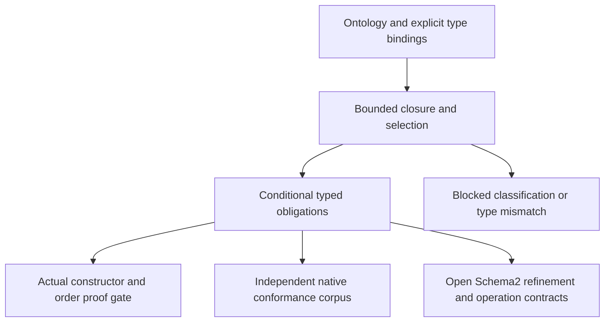

# Ontology requirements to full-width proof obligations

This development integration converts the existing ZAL DeFi classifications
into explicit, source-bound U256/I256 requirements and verification tasks.
It is stacked on ontology PR #168, whose ancestry includes the Schema2 and
actual-type ordering work. It changes no production Rust arithmetic or schema
implementation.

The supplied [ontology](../integrations/zal/examples/ontology/defi_arithmetic.english.txt)
and [bindings](../integrations/zal/examples/ontology/defi_arithmetic.bindings.json)
have this exact mapping:

| Individual | Required classifications | Rust value | Schema2 kind and type ID | Inclusive domain |
|---|---|---|---|---|
| `swapBalance` | `NeedsWideArithmetic`, `NeedsUnsignedArithmetic` | `U256`, `Value::unsigned256` | `TypeKind::U256`, 1 | 0 through 2^256 - 1 |
| `signedPnl` | `NeedsWideArithmetic`, `NeedsSignedArithmetic` | `I256`, `Value::signed256` | `TypeKind::I256`, 2 | -2^255 through 2^255 - 1 |

Both routes explicitly select `SchemaProfile::VALUE2`, `value-profile-2` and
`schema-profile-2`. Type IDs are application bindings, not a new global schema
registry. Full-width declarations select these representable domains; business
constraints such as balance conservation or a particular profit formula still
require their own reviewed contracts.

For words `lo, hi` in `[0, 2^128)`, the unsigned interpretation is
`u = lo + 2^128 * hi`. The signed interpretation is `u` below `2^255` and
`u - 2^256` otherwise. Identical raw bits therefore need not denote identical
integers. Even signed and unsigned zero remain different nominal value kinds.



## Selection and refusal semantics

The pure core recomputes the ontology. It accepts no imported classification or
proof verdict. Its fixed mapping policy interprets names beginning with `Needs`
as requirement names and supports exactly the three names in the table above.
Other names remain opaque ontology symbols. This convention is part of
`zeno-fcis/ontology-arithmetic-handoff/1`; it is not an OWL rule or an inference
from an English label.

| Condition, in precedence order | Result |
|---|---|
| Closure unsupported, incomplete or inconsistent | Preserve that state for every binding; emit no type or obligations |
| Incoherent completion/consistency flags | Incomplete |
| Selected individual absent | Missing |
| Unknown `Needs...` class or unsupported target type | Unsupported |
| Both signed and unsigned requirements established | Inconsistent mapping, even without a disjointness axiom |
| Wide classification or signedness classification absent | Missing; absence remains unknown |
| Exactly one signedness plus width, but requested type differs | Type mismatch; nominal-binding obligation refuted with both types |
| Exact match | Bound conditional requirement; arithmetic and schema obligations remain open |

A mapping conflict is distinct from an ontology contradiction. The packet
retains the original closure, usage, explanations and contradiction witness.
An inferred type never makes an incomplete closure complete. Adding evidence
can block a previously bound requirement; replay detects the changed document.
The absence of an opposite signedness classification is not a negative fact
about the world.

Inputs admit 1..16 distinct individual/type-ID bindings, exact u32 nonzero IDs,
and the ontology's existing 1,024-fact/1,000,000-work caps. Unknown fields,
booleans masquerading as integers, duplicate IDs and oversized requests refuse.
Mutable indexes and output assembly are invocation-local; results contain no
aliases to caller inputs or retained adapter identity dictionaries.

## Contract and evidence boundary

The [source inventory](../integrations/zal/arithmetic_handoff_sources.json)
pins the base revision and 55 contract, configuration, proof and example inputs.
The shell checks these bytes before and after every handoff, fingerprints its
loaded Python implementation, and requires restart after an implementation
change. Canonical ontology content, implementation identity, explicit bindings
and discovered type contribute to the requirement ID. Obligation IDs extend
that ID. Fact IDs resolve through the retained grounded explanation graph.
Git revision labels alone are not evidence; exact file hashes are checked.

Each obligation states its quantified domain, conclusion, actual source file
and API symbols. The kinds deliberately separate different evidence strengths:

| Obligation | Decisive evidence route | Remaining boundary |
|---|---|---|
| `nominal-binding` | Exact type comparison, with supplied/required witness | Conditional on the admitted document and mapping policy |
| `representation` | Existing whole actual-type Verus gate | Constructors/views/sign only; not all arithmetic or compiler/ghost-erasure correctness |
| `numeric-order` | Same gate, tied to actual `U256::cmp` and `I256::cmp` | Verus/vstd/SMT and reviewed source-dialect assumptions |
| `native-corpus` | Actual public Rust methods against Python integer/byte oracles | 1,600 comparison pairs and 320 scalar ranges; finite coverage |
| `schema-C0` | Future constructor refinement | OPEN: normalized, closed, acyclic schemas under caps |
| `schema-S1` | Future recursive value/witness refinement | OPEN: exact nominal shape, ranges, owned value/report |
| `schema-S2` | Future codec2/identity/admission refinement | OPEN: complete canonical consumption and refusal precedence |
| `schema-S3` | Future profile-separation refinement | OPEN: disjoint legacy/profile2 and resource behavior |
| `operation-contracts` | Explicit operation selection followed by implementation proofs | OPEN: operations, overflow, rounding and financial behavior are unspecified |

The MCP handoff leaves all arithmetic evidence open. A separate local
qualification command can run fixed, reviewed proof/test commands and write
obligation assessments. The original handoff remains byte-replayable inside
that record. Assessments never become execution or publication authority.
No interface accepts an imported status as proof or executes replay argv from
a supplied document.

## Replay

From the repository root:

```sh
PYTHONPATH=integrations/zal python3 -B -m zal_notation arithmetic-handoff \
  --source integrations/zal/examples/ontology/defi_arithmetic.english.txt \
  --bindings integrations/zal/examples/ontology/defi_arithmetic.bindings.json
python3 -B tools/ontology_arithmetic_oracle.py --check
python3 -B -m unittest discover -s integrations/zal -p 'test_ontology*.py'
PYTHONOPTIMIZE=1 python3 -O -B -m unittest discover -s integrations/zal -p 'test_ontology*.py'
python3 -B -m unittest discover -s tools -p 'test_check_arithmetic_handoff.py'
python3 -B tools/check_arithmetic_handoff.py --native --formal \
  --out /tmp/ontology-arithmetic-qualification
```

Use a fresh output directory outside the checkout. Native replay requires
pinned Rust 1.97.1 and the locked crate cache. Formal replay requires the pinned
Verus cache and Rust 1.98.1 described in the
[numeric foundations](NUMERIC_256_FOUNDATIONS_27.md); `--verus-cache` selects
an already installed cache. The checker does not install dependencies.
Omitted lanes remain open. A requested lane that fails, times out, does not
compile, or misses a required semantic negative control makes the command
exit 2 and the qualification incomplete. Exit 0 means the requested lanes
finished; inspect each obligation rather than treating it as universal success.

The actual MCP service exposes `zal_arithmetic_handoff` and
`zal_arithmetic_replay`, with separate names preserving all six ontology tools.
They accept `ontology`, `bindings` and optional `max_facts`/`max_work`; replay
also accepts `packet`. No behavioral workspace is opened. The CLI exits 0 for
ready discovery and 2 for blocked discovery or malformed input, and does not
overwrite an existing output file.

## Independent checks and negative controls

The retained [qualification](../experiments/ontology_arithmetic_handoff/qualification.json)
records 21 verified conditions and seven intended Verus method refusals, passing
native conformance, and four native semantic refusals. Its 18 obligation
assessments have eight scoped satisfactions and ten open obligations. The
[type-mismatch packet](../experiments/ontology_arithmetic_handoff/type-mismatch.json)
separately refutes both swapped nominal bindings. The
[validation record](../experiments/ontology_arithmetic_handoff/validation.json)
binds 223 focused Python tests in each of normal and optimized execution,
including existing review/Lens behavior and setup checks. This is component
qualification, not a 2.7 release candidate.

The actual finite selector is checked against an independent table on all 2,304
admitted combinations of closure state, completeness, consistency, presence,
width, signedness, unsupported requirements and selected type. This exhausts
that function's finite domain; it does not prove the entire Python reasoner.

The integer oracle uses Python integers and signed byte decoding independently
of production Rust arithmetic. Forty fixed patterns include 128-bit and 256-bit
boundaries, the sign discontinuity and deterministic hash-derived values.
Rust consumes the generated requirement projection and constructs the actual
Schema2 types. It checks every comparison/range vector, wrong signedness,
narrow-zero refusal, retained values/reports, and a wrong type identity before
hash or validation budget. Deterministic regeneration is checked in CI.

The native gate builds isolated specimens that accept signed values as unsigned,
accept unsigned values as signed, compare signed ranges as raw bits, or swap
the generated signed requirement to U256. Only an intended Rust assertion
failure qualifies a refutation; compile errors, missing tests and resource
failure remain open. The Verus gate separately checks all seven actual-method
defects from PR #167. A refuted mutant does not mean the original implementation
is refuted, and a passing corpus does not discharge a universal Schema2 theorem.

This integration grants no arithmetic, application, transaction, execution,
publication or release authority through ontology inference.
