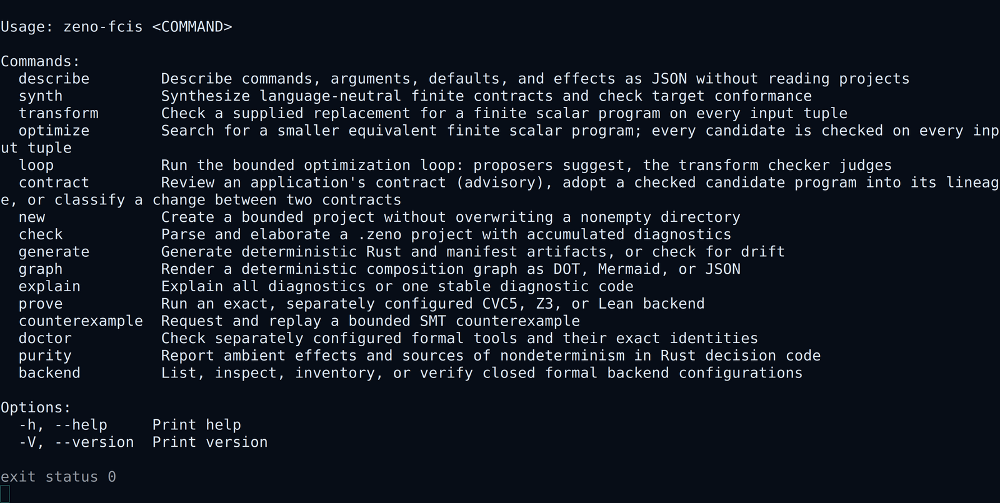

# Tutorial: use the CLI as a checked workflow



Start with one command:

```bash
cargo +1.97.1 run --quiet -p zeno-fcis-cli --locked -- \
  check examples/minimal/project.zeno
```

```text
checked examples/minimal/project.zeno: project=1 components=1 claims=1 unresolved_obligations=2 semantic_program_hash=57385a54387db8ad3e2da9a46a9ae22d2e72502b336120f570791d79e736b365
unresolved obligations: evidence this check does not establish and generated code cannot discharge; they are not errors:
  complete-footprint: component 300 needs evidence that it reads and writes only what its footprint declares
  sequential-parity: the merge needs evidence that the merged components decide as they would one after another
```

The first line shows the project ID, the number of components, the number of
claims, the obligations that still need evidence, and the identity of the
checked program. The lines after it say what each obligation asks for; they
are not errors.

The command also prints two warnings on stderr:

```text
warning: law 400 identity is always true, so it can never detect a faulty transition
warning: claim 500 identity is always true, so proving it says nothing about this system
```

The minimal example's law and claim compare the state with itself, so they
hold for every transition. [Law and claim substance](../CLAIM_SUBSTANCE.md)
explains the classification. `check` also warns about any law or claim path
that names no declared type or field; see
[law path resolution](../LAW_PATH_RESOLUTION.md).

For automation, request JSON:

```bash
cargo +1.97.1 run --quiet -p zeno-fcis-cli --locked -- \
  check examples/minimal/project.zeno --format json
```

```json
{"authority":"none","claims":1,"components":1,"evidence":"authoring-spec","obligations":[{"claim":null,"component":300,"explanation":"component 300 needs evidence that it reads and writes only what its footprint declares","kind":"complete-footprint","peer":null},{"claim":null,"component":null,"explanation":"the merge needs evidence that the merged components decide as they would one after another","kind":"sequential-parity","peer":null}],"path":"examples/minimal/project.zeno","project_id":1,"runtime_admission":"not-run","schema":"zeno-fcis/cli/1","semantic_program_hash":"57385a54387db8ad3e2da9a46a9ae22d2e72502b336120f570791d79e736b365","status":"valid","substance":{"claims":[{"code":"constant-true","id":500,"name":"identity"}],"laws":[{"code":"constant-true","id":400,"name":"identity"}]},"unresolved_obligations":2,"unresolved_paths":{"claims":[],"laws":[]}}
```

The keys appear in a stable order, and the schema has an explicit version.

## Turn problems into actionable output

```bash
cargo +1.97.1 run --quiet -p zeno-fcis-cli --locked -- \
  check examples/diagnostics-tour/project.zeno --format human
```

One run reports every independent problem it can retain. Use `explain` to
focus on one stable code:

```bash
cargo +1.97.1 run --quiet -p zeno-fcis-cli --locked -- \
  explain examples/diagnostics-tour/project.zeno --code ZENO-E0203
```

## Generate, view, and check

```bash
cargo +1.97.1 run --quiet -p zeno-fcis-cli --locked -- \
  graph examples/minimal/project.zeno --format mermaid
cargo +1.97.1 run --quiet -p zeno-fcis-cli --locked -- \
  generate examples/minimal/project.zeno --out generated
cargo +1.97.1 run --quiet -p zeno-fcis-cli --locked -- \
  generate examples/minimal/project.zeno --out generated --check
```

`graph` produces a review view. `generate` writes through temporary files and
renames them into place. `generate --check` only reads and reports drift.

## Use exit codes as decisions

| Code | Meaning |
|---:|---|
| `0` | The requested positive result completed. |
| `1` | The project is invalid or the checked claim has a counterexample. |
| `2` | Required evidence or a required tool is unavailable, or evaluation could not decide. |
| `3` | A tool, file, or bounded execution failed. |
| `64` | The command line is invalid. |

Treat code `2` as blocked: a build system should stop the release or
deployment and keep the reason for review.

The CLI can check source, generate code, draw graphs, explain messages, invoke
approved formal tools, and retain their output. None of these commands can
create permission to update trusted state, receipts, or commits.

The [CLI reference](../CLI_REFERENCE.md) lists every command and option. The
[language tutorial](LANGUAGE.md), [composition tutorial](COMPOSITION.md), and
[formal-tools tutorial](FORMAL_TOOLS.md) provide focused examples.
