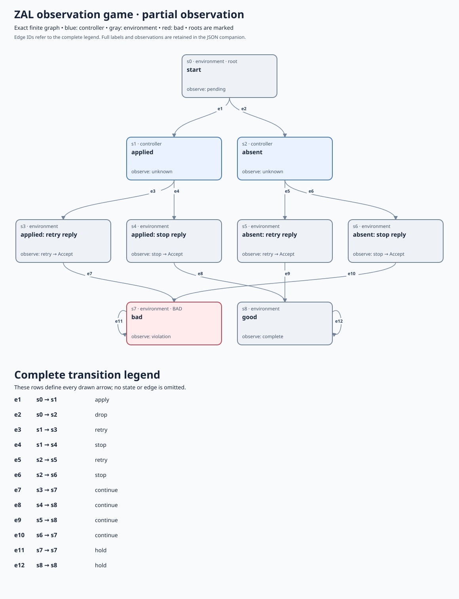
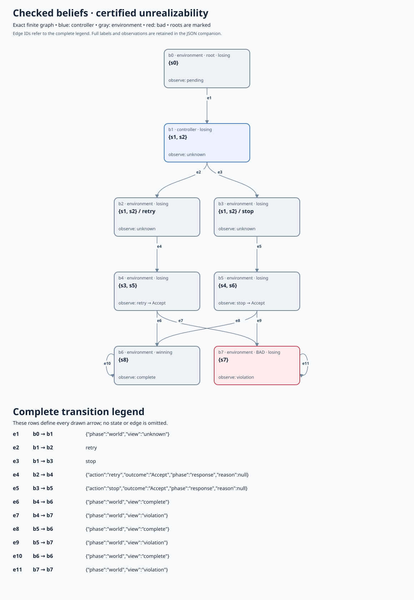
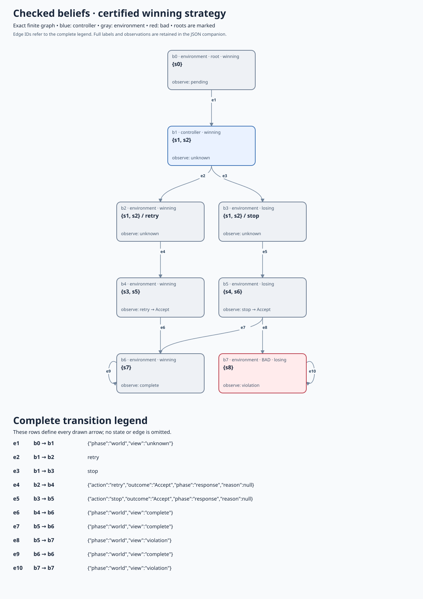
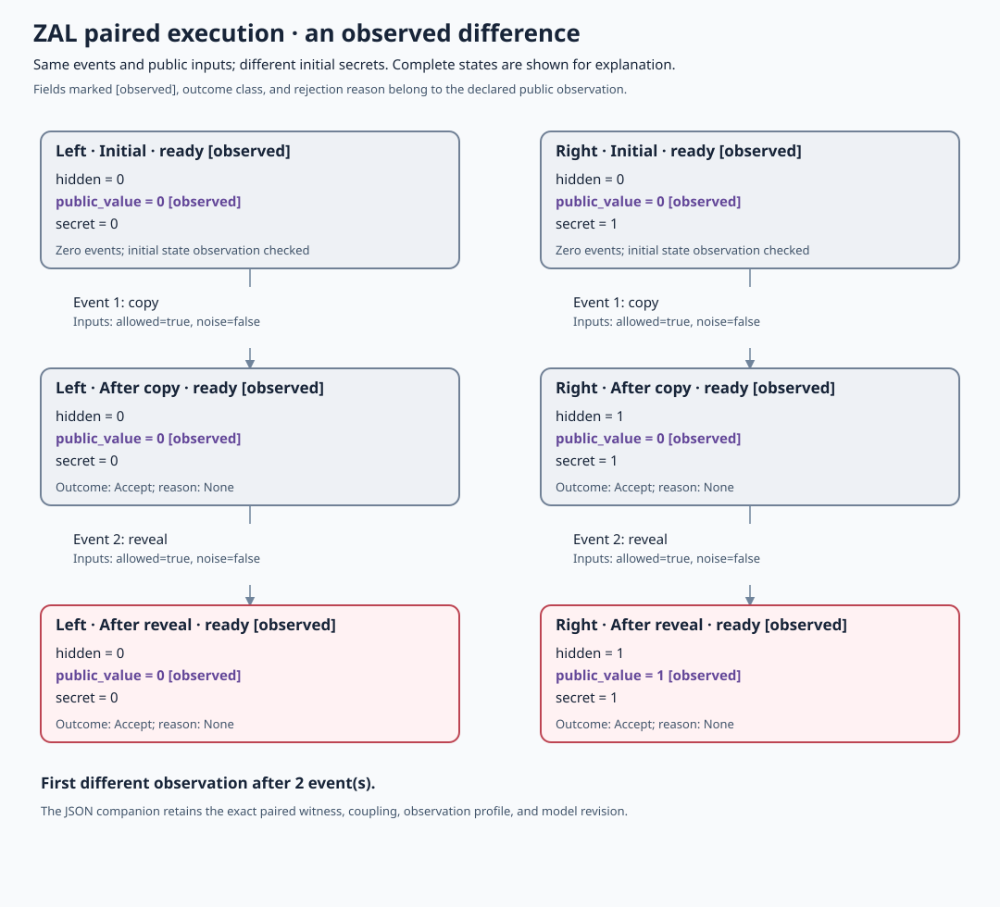

# Observation contracts: what the controller can know and what two runs may reveal

A lost delivery reply leaves two possible worlds: the effect happened, or it
did not. A controller that sees `Unknown` must choose one action that works in
both worlds. Separately, a public result may be valid on every individual run
yet reveal a secret through how the result changes between runs.

This experimental, Python-only route adds explicit observation profiles around
the existing ZAL models and finite arena checker. It checks a controller's
available information and compares synchronized executions. The inputs are
ordinary ZAL sources and small JSON profiles; the output is a source-bound
result that can be replayed. It adds no production Authority, delivery adapter,
native execution, or new meaning to the existing ZAL syntax.

The safety/liveness decomposition still applies to ordinary trace properties.
The additions here change the quantified objects and observations. A pair of
executions can carry a relationship that one execution cannot establish; an
implementable controller must choose using its observed history. These are
additional contract structures, not a third class outside the decomposition.

Stuttering invariance permits repeated observations without changing an
ordinary trace property's truth. It is useful when hiding internal work, but
it does not specify what a controller knows, whether one implementable strategy
works, or what two executions may reveal together. Here observations are an
explicit contract. A state-preserving rejection still exposes its outcome
class and reason through a response node. A distinguishing rejection reason
can change the controller's knowledge and make a strategy possible even when
the business state did not change. Environment choices reveal only the
resulting declared observation. The adapter does not compute a general
stuttering quotient.

The optional cost and service bounds deliberately retain selected transition
counts that a state-only projection would lose. An enabled finite service bound
rejects infinite no-service stuttering. These model obligations do not establish
time divergence or rule out Zeno behavior in a physical
implementation.

## Try the lost-reply example

Run commands from the repository root with Python 3.11 or later. Choose a fresh
output directory outside the checkout for each `game` or `relational` run.
`verify` uses an existing output directory and the exact expected inputs.

```sh
python3 integrations/zal/observations.py game \
  integrations/zal/examples/observations/delivery.zal \
  integrations/zal/examples/observations/delivery.partial.json \
  --out ../delivery-partial-evidence

python3 integrations/zal/observations.py verify \
  integrations/zal/examples/observations/delivery.zal \
  integrations/zal/examples/observations/delivery.partial.json \
  --out ../delivery-partial-evidence
```

Both commands return exit 1 with `UNREALIZABLE`. This is a checked negative
result for this finite model, its observations, and its permitted actions.
It does not assert that every delivery protocol is impossible. Exit 0 means
`CHECKED`; exit 2 means `UNKNOWN` or refusal. A budget stop is never a proof of
unrealizability or a positive result. Replaying valid negative evidence remains
exit 1.

The [ZAL source](../../integrations/zal/examples/observations/delivery.zal)
describes five physical-model states. The
[profile](../../integrations/zal/examples/observations/delivery.partial.json)
declares who chooses each transition and what the controller observes:

| Physical model state | Observation | Permitted choice | Requirement |
| --- | --- | --- | --- |
| `start` | `pending` | Environment: `apply` or `drop` | Model one uncertain delivery |
| `applied` | `unknown` | Controller: `retry` or `stop` | Retain the one effect |
| `absent` | `unknown` | Controller: `retry` or `stop` | Complete the missing effect |
| `good` | `complete` | Environment: `hold` | Explicit absorbing success |
| `bad` | `violation` | Environment: `hold` | Explicit absorbing violation |

The action alphabet excludes waiting and all other undeclared protocol actions.
The profile makes that choice explicit; it is an assumption about the protocol,
not something inferred from the controller. First service must occur within
two original model transitions: the environment choice and the controller
operation. The total graph continues after service, and safety remains checked.

The expanded arena below is generated from parsed ZAL decisions. It includes
response nodes because an unchanged state does not make a rejection or response
invisible. Each arrow has a complete legend entry. The
[JSON companion](diagrams/observations/delivery_partial.json) binds the model,
profile, compiled graph, and checked certificate digest. Open the SVG at full
size to read the full graph; the table above gives the same physical-state view.



After `unknown`, the controller's belief is the set `{applied, absent}`. The
same action must be selected for that belief. Retrying is bad in the first
world; stopping is bad in the second. The checked belief graph preserves both
possibilities. Here `s` labels refer to concrete arena nodes and `b` labels to
belief-graph nodes; the numeric identifiers have separate namespaces.



This is the distinction between a successful choice for each world and one
causal strategy for every world consistent with the observation:

\[
\exists\sigma\;\forall E\in\mathcal E:\quad
\operatorname{Run}(\sigma,E)\models P.
\]

The strategy uses the history of observations and its own actions. It cannot
read the hidden concrete state. The existing arena checker independently
checks all submitted belief-transition equations and then checks the strategy
closure or the losing ranks. Search results alone are not accepted.
Replay also repeats the bounded search to validate the declared state, edge,
and work allowances. The Python ZAL evaluator and arena adapter remain trusted;
reusing the adapter is not an independent proof of compiler correctness.

## Change information or change the destination contract

The fixtures expose two different repairs and a resource boundary:

| ZAL source | Profile | Expected result | What changed |
| --- | --- | --- | --- |
| `delivery.zal` | `delivery.partial.json` | `UNREALIZABLE` | Applied and absent are indistinguishable |
| `delivery.zal` | `delivery.perfect.json` | `CHECKED` | Controller can distinguish the full concrete state |
| `delivery_idempotent.zal` | `delivery_idempotent.partial.json` | `CHECKED` | Retry preserves one effect in either world |
| `delivery_idempotent.zal` | `delivery_idempotent.cost.json` | `UNREALIZABLE` | Retry costs two abstract units; the permitted total is one |

Perfect information is an additional assumption, not evidence that an actual
shell can learn whether delivery occurred. The
[idempotent source](../../integrations/zal/examples/observations/delivery_idempotent.zal)
instead changes one physical-model transition: retrying an already applied
request reaches `good`. A destination must separately establish that behavior
for its request identity. The winning strategy is then the uniform `retry`
choice, even while the observed outcome remains uncertain.



The cost monitor counts declared abstract event units for the entire modeled
run. It includes selected environment transitions and rejected controller
operations. Synthetic response nodes cost zero; they present the result of
one operation and are not another physical operation. `max_cost: null` disables
this monitor and makes no zero-cost claim. The service monitor independently
counts original model transitions, including environment and rejected steps.
Its bound is an event count, not seconds, native instructions, or a measured
latency. With `response_bound: null`, `service_states` must be empty and no
completion claim is made.

## Compare two executions, including delayed leaks

The relational route uses an existing `zal 2` transition model. A profile
declares at least two initial alternatives for secret variables, partitions
every context field into public or secret, and selects observed state fields.
Every paired step uses the same event and equal public context, while secret
context varies independently. Outcome class and rejection reason are always
observed, even when no state field is selected.

```sh
python3 integrations/zal/observations.py relational \
  integrations/zal/examples/observations/relational_private.zal \
  integrations/zal/examples/observations/relational_private.json \
  --out ../relational-private-evidence

python3 integrations/zal/observations.py relational \
  integrations/zal/examples/observations/relational_delayed_leak.zal \
  integrations/zal/examples/observations/relational_delayed_leak.json \
  --out ../relational-leak-evidence
```

The private fixture returns `CHECKED`. The delayed-leak fixture returns a
`COUNTEREXAMPLE` containing both executions and their first different
observation. Checking only the initial decision would miss a secret copied
into an intermediate variable and revealed by a later event.

The following paired diagram comes from that exact replayed witness. Both
copies accept `copy` and `reveal`; their public values diverge only after the
second event. The [JSON companion](diagrams/observations/relational_leak.json)
retains the full contexts, outcomes, observer, and paired states.



The checker explores the complete reachable product of two model executions,
subject to explicit state, edge, and work budgets. Completion therefore covers
every finite synchronized history in the declared finite model, not just words
up to a chosen test length. A resource stop gives `UNKNOWN`. Replay recomputes
that product and compares the exact result. This route is not asynchronous
trace equivalence, probabilistic noninterference, unrestricted hyperproperty
checking, or a proof about generated native code.

## What the five additional dimensions mean here

| Dimension | Implemented check in this increment | Remaining boundary |
| --- | --- | --- |
| Relationships between runs | Equality of selected observations over a complete finite synchronized product | No arbitrary hyperproperty language or native-code correspondence |
| Knowledge and realizability | Existing partial-observation sure-safety certificates over an explicit ZAL-to-arena adapter | No unbounded partial-observation liveness or external knowledge oracle |
| Quantitative obligations | Explicit cumulative event-cost monitor and first-service event bound | No automatic cost inference, wall-clock bound, or performance measurement |
| Context and composition | Owner, action alphabet, observations, and environment branches are explicit and source-bound | No universal secure-compilation or assume/guarantee composition theorem |
| Adequacy and nonvacuity | Explicit positive service requirement; at least two initial secret alternatives; preserved negative witnesses | No mathematical proof of human intent |

The bridge is intentionally limited. Game input is context-free
`zal/finite-fsm/1`; its declarations and source invariants remain meaningful.
Unresolved obligations are refused. Relational input is the admitted bounded
transition fragment of `zal/finite-fsm/2`; temporal, game, fairness, symmetry,
and unresolved declarations are refused by that route rather than discarded.
The profile version does not change existing [ZAL grammar](GRAMMAR.md).

## Reproduce the diagrams and check their correspondence

Diagrams are generated artifacts, not handwritten evidence. Each SVG draws
every submitted graph node and edge, and its JSON companion retains complete
labels. Belief diagrams are emitted only after certificate checking against
the exact arena. Rendering is limited to 64 nodes and 256 edges and refuses a
larger graph; a rendering refusal does not change the model's check result.

```sh
python3 integrations/zal/observation_diagrams.py \
  integrations/zal/examples/observations/delivery.zal \
  --profile integrations/zal/examples/observations/delivery.partial.json \
  --out docs/zal/diagrams/observations --name delivery_partial --check

python3 integrations/zal/observation_diagrams.py \
  integrations/zal/examples/observations/delivery_idempotent.zal \
  --profile integrations/zal/examples/observations/delivery_idempotent.partial.json \
  --out docs/zal/diagrams/observations --name delivery_idempotent --check

python3 integrations/zal/observation_diagrams.py \
  integrations/zal/examples/observations/relational_delayed_leak.zal \
  --profile integrations/zal/examples/observations/relational_delayed_leak.json \
  --mode relational --out docs/zal/diagrams/observations --name relational_leak --check

python3 -m unittest discover -s integrations/zal -p 'test_observation*.py'
python3 -m unittest discover -s integrations/zal -p 'test_relational_observation.py'
```

Omit `--check` only to regenerate intentionally changed views. The checker
tests compare diagram edges with graph transitions, reject altered certificates
and omitted possible worlds, round-trip the ZAL English view, and reject stale
generated files. The generated
[English source](diagrams/observations/delivery_partial.english.txt) is another
reading of the same ZAL model; it does not add owner agreement or adoption.

Result bundles bind the exact source and profile bytes, Python version,
checker source identities, budgets, and result bytes. A changed dependency
makes old replay evidence stale. The binding is integrity and provenance data,
not authentication or execution authority.

## Foundations and related routes

- [Alpern and Schneider: Defining Liveness](https://www.cs.cornell.edu/fbs/publications/85-650.pdf) explains the safety/liveness decomposition.
- [Clarkson and Schneider: Hyperproperties](https://www.cs.cornell.edu/fbs/publications/Hyperproperties.pdf) treats relationships over sets of executions and the corresponding decomposition.
- [Halpern and Moses: Knowledge and Common Knowledge in a Distributed Environment](https://arxiv.org/abs/cs/0006009) develops reasoning about observations and knowledge.
- [Abate et al.: Journey Beyond Full Abstraction](https://arxiv.org/abs/1807.04603) studies robust preservation against adversarial contexts; this increment does not implement those general guarantees.
- The existing [finite trace-game certificates](../TRACE_GAME.md), [temporal contract](ladder/TEMPORAL.md), and [withdrawal pilot](ladder/WITHDRAWAL_PILOT.md) retain their own scopes.
- The [shell effects model](../SHELL_EFFECTS.md) preserves actual protocol outcomes such as `Sent`, `NotSent`, and `Unknown`. Connecting those implementations to the new illustrative physical-world model remains a separate refinement obligation.
