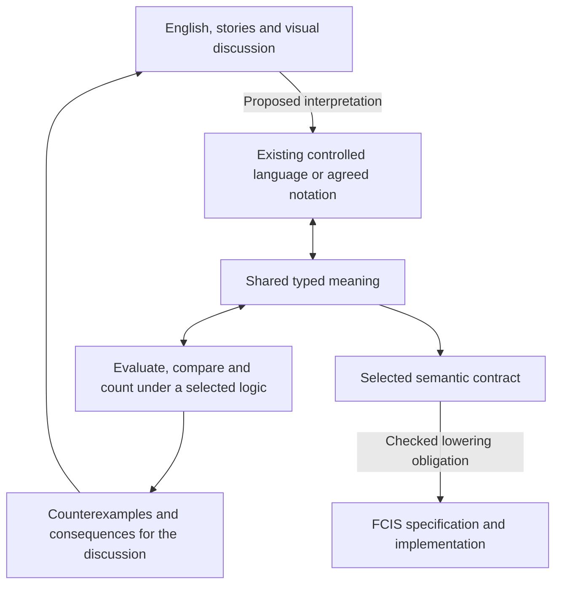

# Where relational reasoning belongs in ZAL

ZAL's intended workflow connects human meaning to implementation. Reasoning
helps select and refine that meaning, expose contradictions and check proposed
transformations. Implementation must then preserve the selected contract. A
model-level result alone does not close the lowering-to-code obligation.

The existing presentations are Question, Plain, Intuitive, Precise, Formal,
Typed and Formula. They are coordinated readings of a declared meaning. English
or a story can begin above that precise boundary: an LLM can propose a controlled
reading, while retaining unresolved choices for people to inspect. That proposal
is not an automatically proved translation of unrestricted human language.

The new backend plugs into the reasoning box for the supported C2/C2mod profile.
It is not a new presentation rung or a requirement that every ZAL abstraction
fit two-variable logic. Other profiles can support other computation models.

For example, two readings of “every owner has a car” differ over a model where
one owner has two cars. The backend makes that distinction inspectable. People
choose the intended rule. A later implementation translator must preserve the
chosen rule, its assumptions and its required observations; an implementation
that accepts the wrong case must be rejected by the corresponding check.

## Implemented placement and language roles

| Part | Current implementation and scope |
|---|---|
| Controlled English | Existing Python `integrations/zal/ladder.py` and declarative `ladder_en.json`; reused by the new adapter. |
| C2/C2mod admission and meaning | Haskell `Syntax.hs`, `Finite.hs`, `Normalize.hs`; immutable typed formulas and explicit profile refusal. |
| Counting and comparison | Haskell `Population.hs`, `Budget.hs`, `Compare.hs`, plus bounded expansion audits. |
| Transport and discussion | Python CLI/process boundary, source bindings, CNL bridge and formal-request replay. |
| Independent testing | Separately written Python original-formula oracle; compiled negative controls; Lean arithmetic lemmas. |
| Native FCIS | Existing Rust system; this PR supplies no new native registration or checked relational-to-FCIS lowering. |
| Visual notation | Existing separate notation work; no new visual-to-relational bridge is claimed here. |

Haskell was selected for the new pure transformations and algorithms. Python
reuses the existing CNL parser and test machinery and keeps the oracle independent.
The versioned JSON boundary can be called from Rust; today its supported CLI
still runs Python and Haskell. A direct Rust adapter is not implemented. Replacing
Python is an integration choice and requires preserving all ingress, process and
evidence contracts; changing language alone does not prove them.

The immediate missing connections are a visual adapter that preserves shared
model identities, modular-counting CNL, and a checked translation into an FCIS
contract/implementation for a declared supported profile. The complete ladder is
unfinished until those connections and their obligations are addressed.
