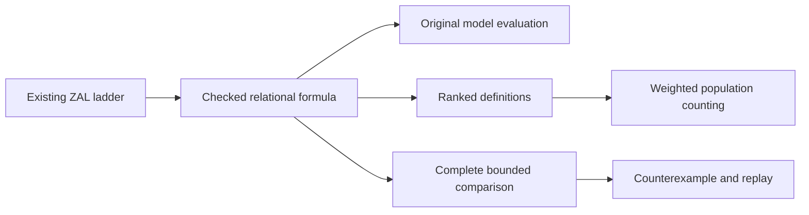

# Optional ZAL relational backend

This experiment adds exact finite C2/C2mod model counting, concrete-model
evaluation, bounded formula comparison and replayable discussion results to ZAL.
Haskell implements the pure semantic core. Python supplies the strict JSON and
process boundary, the existing CNL adapter, and an independent finite oracle.

The backend is optional and **not installed in the native 2.7 registry**. Its six
arithmetic lemmas have Lean proofs; the full Haskell implementation does not yet
have a source-level correctness proof. Read [ASSURANCE.md](ASSURANCE.md) before
treating results as evidence for a larger system.

## Build and use

The reference environment is Linux with Python 3.10+, GHC 9.4.7, aeson 2.1.2.1,
base 4.17.2.0, containers 0.6.7, text 2.0.2 and bytestring 0.11.5.2. The executable
build checks these versions. On Ubuntu 24.04, the GHC/aeson distribution packages
provide this environment. The Cabal manifest records the same direct dependencies;
the qualified build invokes GHC directly, without a Cabal dependency-solver claim.

From this directory:

```sh
python3 build.py
python3 run.py examples/owner-car-count.json
python3 run.py examples/even-graph-count.json
```

The counts are 137 and 2. The first counts structures on two labeled entities
satisfying “every owner has a car,” allowing overlapping classes, shared cars and
no owners. The second counts simple undirected graphs on three labeled vertices
with even degrees: the empty graph and the triangle.

Use `run.py` as the public ingress. The worker's JSON-lines protocol is internal;
the shell rejects duplicate keys and oversized inputs before invoking it. It
binds answers to the request, implementation and declared scope. Signed weighted
zero is not evidence of unsatisfiability. Counts are not automatically probabilities.

## Discuss two meanings

```sh
python3 demo_decisions.py --out /tmp/zal-meaning-demo-new
python3 replay_result.py /tmp/zal-meaning-demo-new/discussion.json
python3 run.py /tmp/zal-meaning-demo-new/left-model.json
python3 run.py /tmp/zal-meaning-demo-new/right-model.json
```

Choose a new output directory. The demo uses this checkout's existing ZAL ladder.
It compares “every owner has a car” with an exactly-one-car reading, under explicit
assumptions of one owner and disjoint owner/car classes, at domain size 3.
The counterexample is one owner with two cars. The two evaluation commands return
true and false for that same model. Exactly-one implies at-least-one in the
complete comparison domain.

The discussion retains both texts, their rungs, the context and lowering bindings,
the formal request and the result. Another participant can replay the formal
request without running the CNL parser. Replay does not authenticate a participant,
approve the interpretation or prove arbitrary-English translation.

The adapter also supports a direct comparison:

```sh
python3 ladder_adapter.py \
  --context examples/owner_cars_context.json \
  --rung intuitive --text 'every owner has a car.' \
  --compare-rung typed \
  --compare-to 'forall x in D: Owner(x) => (exists1 y in D: Car(y) and Has(x, y))' \
  --domain-size 2 --out /tmp/zal-reading-comparison.json
```

The output file must be new. `--native-root` selects another checkout explicitly;
the default is this repository. Existing `exists1` syntax lowers to counting-1.
A third simultaneously live variable is refused instead of being aliased.

## Validate

```sh
python3 validate.py
python3 validate.py --with-lean
```

The second command also needs Lean 4.28.0. Each run uses fresh mutation/discussion
directories and writes a current `evidence/public-validation.json`. A failed run
leaves no old success summary at that location. The driver checks that its runtime
sources, fixtures and ladder dependencies stay unchanged throughout qualification.
The committed [VALIDATION.json](VALIDATION.json) records the local public-tree run;
hosted CI is a separate result.

Checks include 409 weighted count comparisons, 432 original-model evaluations,
432 unique-extension checks, 36 graph identities, 105 formula comparisons,
38 public evaluations, six compiled incorrect counters, malformed/resource and
forged-response controls, 21 CNL round trips, eight story fixtures, 132 FCIS
observation vectors, and the complete 32,768-structure discussion oracle.

The observation bridge compares the actual Haskell observation bodies with the
included finite FCIS example vectors. It does not run a native FCIS binary or
establish the generic counter's correctness. The included native contracts and
wrong-policy fixtures can be examined separately, for example:

```sh
zeno-fcis contract review fcis/contracts/observation_k2_m3 --gaps --format json
```

## Architecture and limits



See [SPECIFICATION.md](SPECIFICATION.md) for the supported semantics,
[OPERATIONS.md](OPERATIONS.md) for the three public request formats, and
[ASSURANCE.md](ASSURANCE.md) for proof obligations and evidence limits.
See [LADDER.md](LADDER.md) for placement in ZAL, the existing controlled-English
and visual layers, and the Haskell/Python/Rust roles.
The JSON count schema is in [schemas/relational-query.schema.json](schemas/relational-query.schema.json).

The core uses only base and containers; aeson/text/bytestring are in the internal
transport adapter. Inputs and semantic results are immutable Haskell values.
There is no model call, global cache, random search, persistent state or effect
authority in the core. Arithmetic is exact. Resource refusal carries no completed
count or relation verdict.

General satisfiability, unspecified-size finite satisfiability, unlabeled counting,
arbitrary program equivalence, modular-counting CNL and native registry integration
remain outside the implemented profile. A comparison at one size does not prove
equivalence at every size. The complete-enumeration comparator can refuse a problem
whose structured count the population engine can compute.
